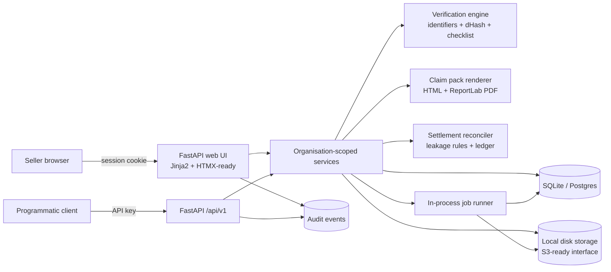

# ReturnProof

**Prove what you shipped. Recover what you are owed.**

ReturnProof is an evidence-backed returns, product-identity verification and
financial-recovery operations platform for Indian e-commerce sellers on
Amazon.in, Flipkart, Meesho, Myntra-style marketplaces.

> Built for the VISHWAKARMA engineering programme. All demo records are
> synthetic. ReturnProof does **not** call marketplace APIs, paid APIs or local
> LLMs.

---

## The problem

An Indian D2C seller loses money in four recurring ways:

1. A buyer returns a different, used, incomplete or empty unit, but the refund
   has already been issued.
2. The seller cannot prove what was actually dispatched, so a marketplace
   rejects the dispute.
3. A settlement under-pays a claim, over-charges commission, or charges reverse
   shipping on a return that never arrived.
4. The seller cannot see how much money is at risk across marketplaces and
   months, or how much has actually been recovered.

ReturnProof closes that loop: capture tamper-evident evidence at dispatch and
return receipt, verify the unit, build a claim pack, file the claim, reconcile
settlements and track recovery.

## What it does

| Capability | What you get |
|---|---|
| Evidence vault | Photos, videos and documents stored behind a storage interface; SHA-256 per file and an append-only hash chain per order; tamper-check endpoint. |
| Identity verification | Serial / IMEI / barcode / batch comparison, perceptual image-hash distance, seal/accessories/tags/weight checklist; `MATCH`, `MISMATCH` or `NEEDS_REVIEW` with reasons and score. |
| Claim packs | Data-driven generic, Amazon SAFE-T-style and Flipkart-style templates; standalone HTML and PDF packs with evidence thumbnails, hashes, timeline and reasons. |
| Claim lifecycle | `DRAFT → FILED → APPROVED / REJECTED / PARTIAL`, claim amounts and marketplace claim windows. |
| Financial recovery | Settlement CSV import (canonical + Amazon/Flipkart-style aliases), reconciliation against orders/returns/claims, leakage detection, recovery ledger, money-at-risk vs recovered per marketplace/month. |
| Seller UI | Dashboard, order and return lists with filters, return detail with gallery and timeline, claim preview/download, settlement import, recovery report, audit log, CSV exports. |
| Operations | Append-only audit events, structured JSON logs, request IDs, login rate limiting, background job abstraction, HTML/JSON error pages, tagged OpenAPI docs. |
| Multi-tenancy | Organisation-scoped queries everywhere; owner/ops/viewer roles; session login and hashed API keys. |

## Screenshots

Screenshots are kept out of the repository to avoid large binaries. Add them
under `docs/screenshots/` (see the placeholder README there) and update this
table:

| Screen | File |
|---|---|
| Dashboard | `docs/screenshots/dashboard.png` *(placeholder)* |
| Return detail + evidence | `docs/screenshots/return-detail.png` *(placeholder)* |
| Claim pack preview | `docs/screenshots/claim-pack.png` *(placeholder)* |
| Recovery report | `docs/screenshots/recovery.png` *(placeholder)* |

## Quickstart

Requires Python 3.12.

```bash
git clone <repo-url> returnproof
cd returnproof
python -m venv .venv
# Windows: .venv\Scripts\activate
# macOS/Linux: source .venv/bin/activate
python -m pip install -e ".[dev]"
alembic upgrade head
python -m returnproof.demo --reset
uvicorn returnproof.app:app --reload --port 8000
```

Open <http://localhost:8000/login>.

The demo prints a seller login; the fixed sample credentials are:

```text
Email:    owner@nirvaanretail.example
Password: ReturnProof@2026
```

Other sample users (same password): `ops@nirvaanretail.example` (ops) and
`viewer@nirvaanretail.example` (viewer). A second organisation,
`owner@kolkatacraft.example`, exists to demonstrate tenant isolation.

The demo seeds orders, returns, evidence images, verification results, claim
packs and recovery rows, and prints the login for the primary seller.

### Windows helpers

```powershell
.\tasks.ps1 install
.\tasks.ps1 check      # ruff + mypy + pytest
.\tasks.ps1 demo
.\tasks.ps1 run
```

`make check`, `make demo`, `make api-key` and `make run` provide the same
shortcuts on Unix-like shells.

## Configuration

All settings use the `RETURNPROOF_` prefix and can live in `.env`.

| Variable | Default | Purpose |
|---|---|---|
| `RETURNPROOF_DATABASE_URL` | `sqlite:///./returnproof.db` | SQLAlchemy URL; Postgres-ready |
| `RETURNPROOF_SECRET_KEY` | dev placeholder | Session signing; set in production |
| `RETURNPROOF_UPLOAD_DIR` | `var/evidence` | Local evidence storage root |
| `RETURNPROOF_PACK_DIR` | `var/packs` | Generated claim pack root |
| `RETURNPROOF_PHASH_THRESHOLD` | `8` | Max visual dHash distance for a match |
| `RETURNPROOF_WEIGHT_TOLERANCE_GRAMS` | `25` | Minimum weight tolerance |
| `RETURNPROOF_WEIGHT_TOLERANCE_PERCENT` | `5.0` | Percentage weight tolerance |
| `RETURNPROOF_SETTLEMENT_TOLERANCE_PAISE` | `100` | Fee variance tolerance |
| `RETURNPROOF_DEFAULT_COMMISSION_PERCENT` | `12.0` | Fallback commission rate |
| `RETURNPROOF_RATE_LIMIT_AUTH_PER_MINUTE` | `10` | Login attempts per IP per minute |
| `RETURNPROOF_MAX_UPLOAD_MB` | `50` | Evidence upload limit |

Money is stored as **integer paise**. Timestamps are stored in UTC and shown in
IST in the UI.

## Architecture



Key invariants:

- Every business row carries `org_id`; repository functions require it.
- Evidence is immutable through the API: each file gets SHA-256, a chain index and
  a `previous_hash`, and the chain is re-verified from disk on demand.
- Claims reference the verification result and marketplace claim window.
- Settlement detection is idempotent per settlement line/category, so
  re-running reconciliation does not duplicate ledger entries.
- CSV exports neutralise spreadsheet formula injection.

See [docs/ARCHITECTURE.md](docs/ARCHITECTURE.md) for the detailed design and
[docs/API.md](docs/API.md) for endpoint examples.

## API in 30 seconds

Create a key for the sample owner:

```bash
python -m returnproof.apikey_cli --email owner@nirvaanretail.example --name local-dev
```

```bash
curl -H "Authorization: Bearer rp_..." http://localhost:8000/api/v1/orders
curl http://localhost:8000/api/v1/recovery/summary \
  -H "Authorization: Bearer rp_..."
```

Interactive docs: <http://localhost:8000/docs> (grouped by tag) and
<http://localhost:8000/redoc>. Health: `GET /healthz`.

## Quality gates

```bash
ruff check returnproof tests
mypy returnproof
pytest --cov --cov-report=term-missing --cov-fail-under=85
```

GitHub Actions runs lint, type check and tests with the coverage gate on Ubuntu
and Windows, Python 3.12.

The test suite uses only synthetic records and generated images. It never makes
network calls.

## Repository layout

```text
returnproof/
  api/            versioned JSON API routers
  domain/         SQLAlchemy models and enums
  web/            server-rendered pages and filters
  templates/      Jinja2 UI + standalone claim pack
  static/         small CSS, no JS build
  data/           claim template registry
  storage.py      local/S3-ready storage interface
  evidence.py     hash chain + tamper verification
  verification.py identity checks
  claims.py       pack rendering + lifecycle
  settlements.py  CSV parsing, leakage rules, ledger
  exports.py      formula-safe CSV exports
  jobs.py         in-process background jobs
alembic/          migrations
samples/          synthetic settlement CSV examples
docs/             architecture, API, roadmap, progress
tests/            pytest suite
```

## Limits and safety

- No real marketplace credentials, APIs or scrapers are used.
- No payment, messaging or LLM service is contacted.
- Evidence tamper checks detect edits to files, metadata and chain links; they
  are not a remote notarisation service. Anchor chain heads externally if you
  need that guarantee.
- Local disk storage is the default. The `Storage` protocol is intentionally
  small so S3/object storage can be added without changing evidence logic.
- SQLite is used for local development; `DATABASE_URL` accepts Postgres.

## Roadmap

See [docs/ROADMAP.md](docs/ROADMAP.md). Near-term work: S3 storage, Postgres
deployment, barcode/OCR-assisted capture, courier webhooks, Celery-backed jobs,
SSO and external hash-chain anchoring.

## License

MIT © 2026 Nishant Tyagi. See [LICENSE](LICENSE).
